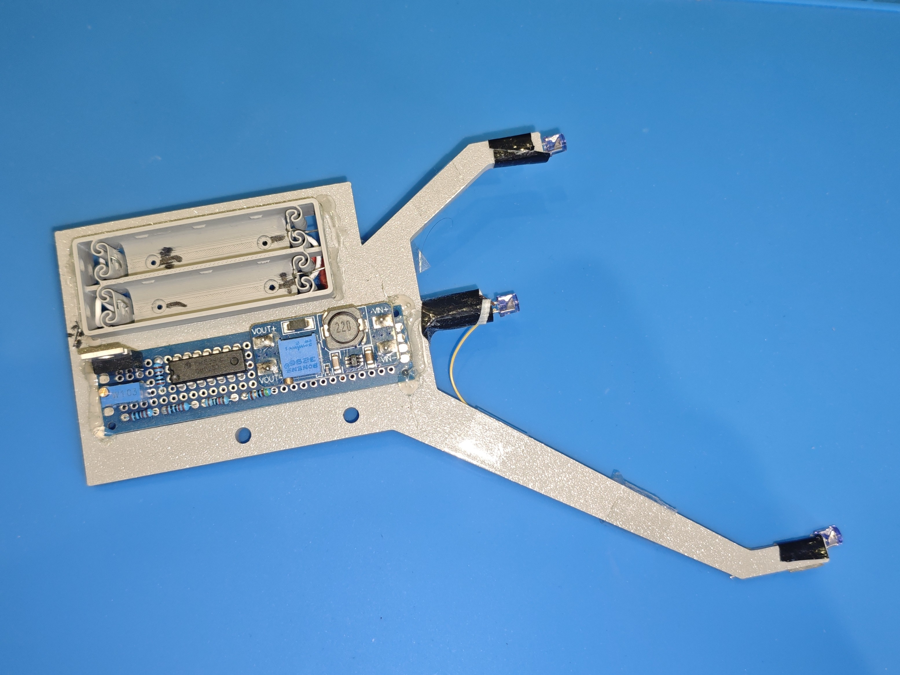
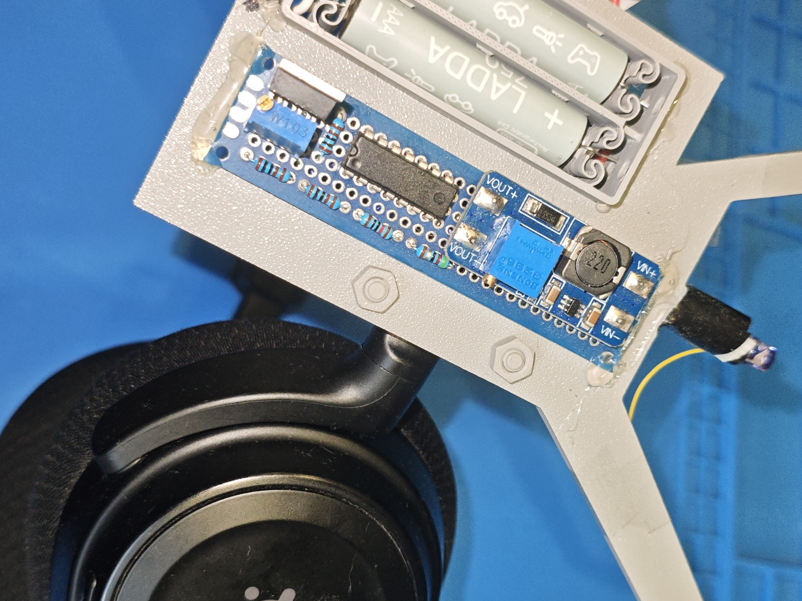
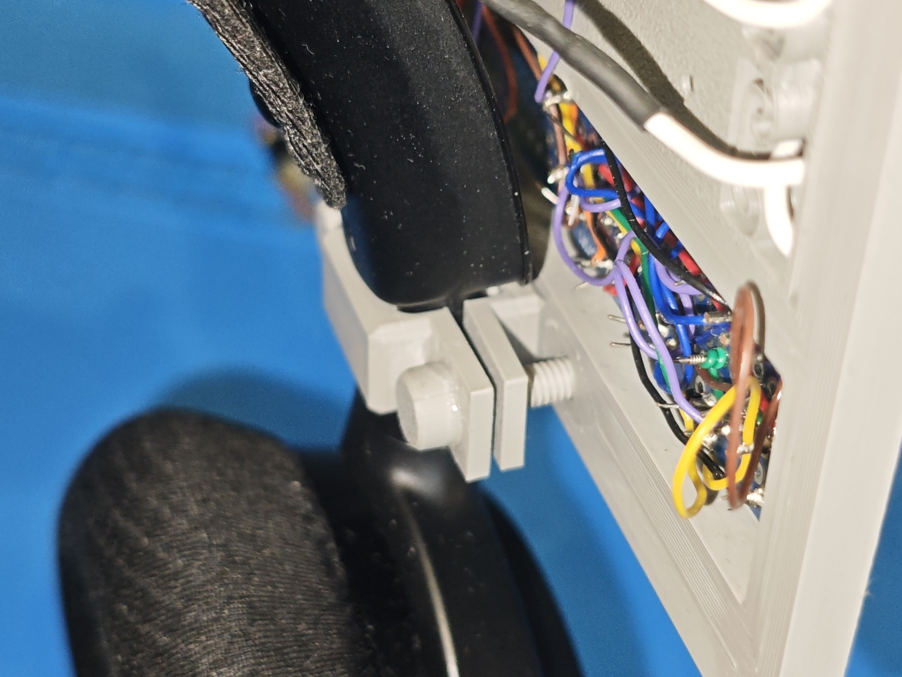
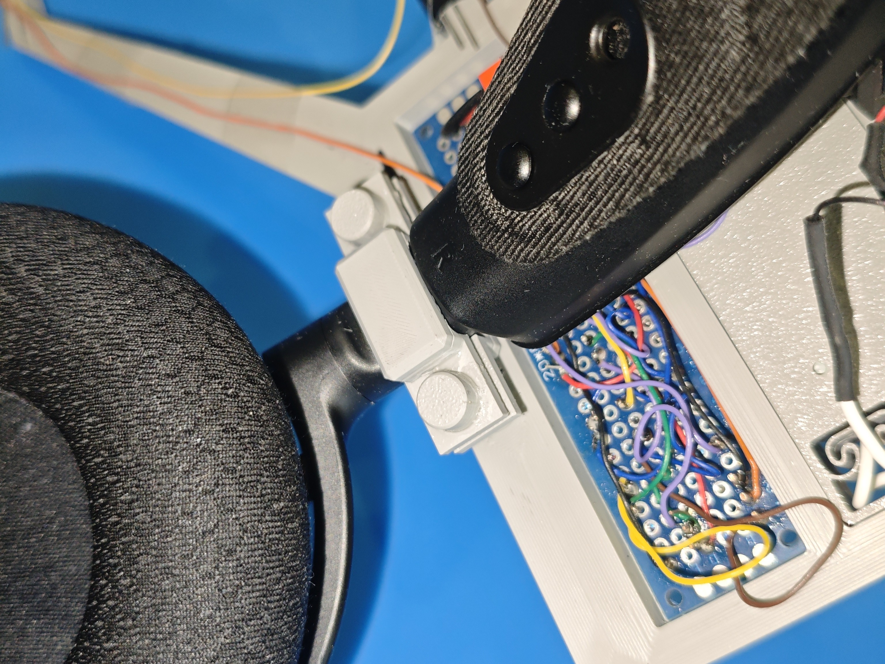
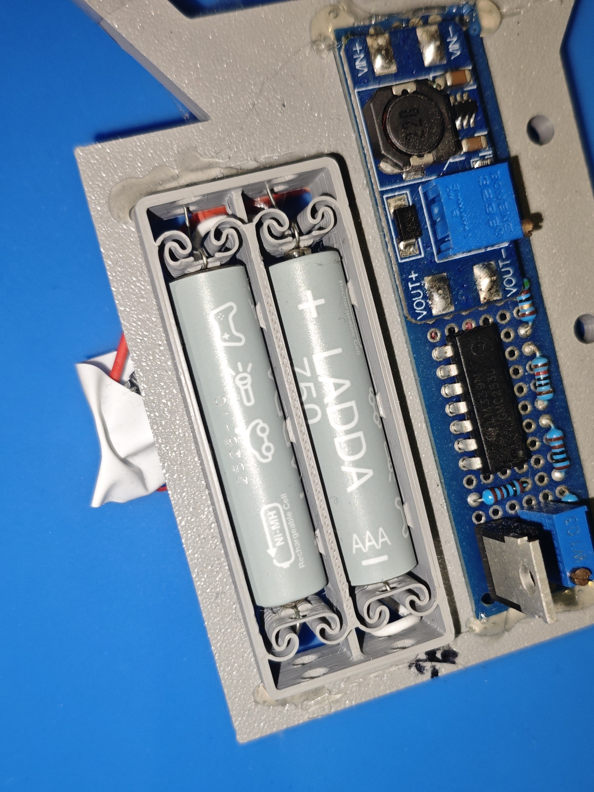
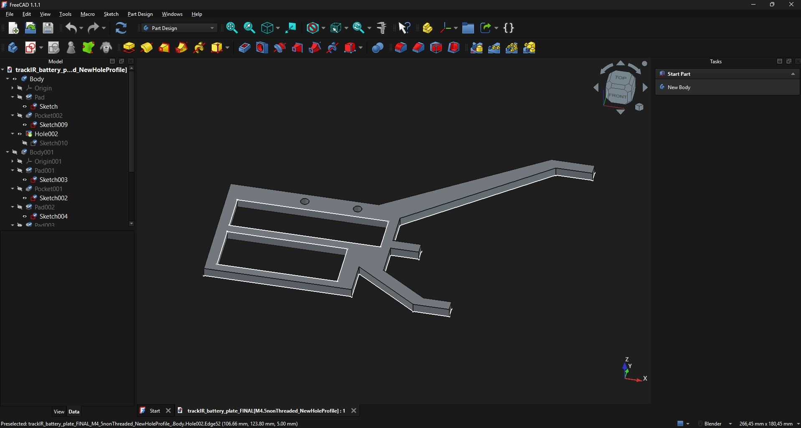

## Overview
The headtracker uses 3 IR LEDs to track the user's head position, through the use of opentrack, for use as computer input.

## Features
- 3 IR LED'S to be used for tracking
- Battery over-discharge protection circuit
- Built-in battery holder
- Universal mounting system

## Demo
https://github.com/user-attachments/assets/57b9c2b3-ec6a-435f-9ab7-8593bbe9145c

## Design Objectives
- low cost
- compatibility with opentrack
- replacable batteries

## Software
Opentrack - tracks the position of the LEDs and converts it into system usable computer input

## Schematic

## Hardware
### LEDs
SFH485P LEDs were chosen due to:
- high efficiency
- 1.5V forward voltage
- sufficient IR light emission
The LEDs are arranged in a unique geometry to determine the head's 3D position via 2D LED tracking.

### Power
- 2x AAA NiMH batteries wired in series: very common and easy to swap, voltage high enough to drive logic. Offering ~2000mAh capacity. This equates to ~10h of runtime.
- Switching boost converter: keeps the voltage at a constant level of 6V, this is optimal for driving 3 LEDs wired in series, LEDs stay at the same intensity, requires battery protection circuit to avoid over-discharge
- 51 ohm resistor wired in series with the LEDs, used as a current limiter

### Battery Protection Logic
The battery protection circuit uses 1 comparitor with a reference voltage set to 2.2V. If the input voltage drops below reference, the comparitor changes state and stops driving the MOSFET which powers the boost converter, preventing over-discharge.

The LM339 comparitor was used because of its:
- low cost
- more than sufficient performance

For the MOSFET. IRLZ44N was utilized as it has low RDS at operation voltages of the system.

### Chassis
The chassis is made of 3D printed PLA plastic.
PLA was chosen as it offers:
- ease of manufacture
- good rigidity
- sufficient mechanical strength

### Mounting system
Headset mounting system:

Battery mounting system, utilizes compliant parts which act as springs.

## CAD

## BOM
- 3x SFH485P LEDs
- 1x LM339N comparitor
- 1x IRLZ44N MOSFET
- 1x MT3608 boost converter
- 1x 10k ohm, 3x 1k ohm, 1x 51 ohm resistors
- 1x 0-10k potentiometer
- variety of 20guage wires
- 6x28 through-hole perfboard

## Tool's used
- FreeCAD cad software
- Bambu Lab A1 3D printer
- OpenTrack software
- KiCad

## Limitations

- The battery life is limited due to the use of AAA batteries
- The LEDs are not strong enough to overcome direct sunlight exposure
